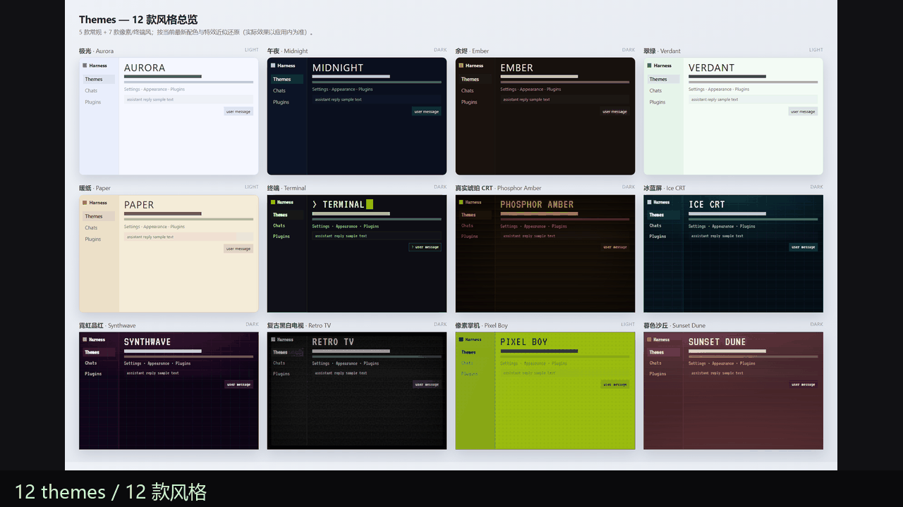
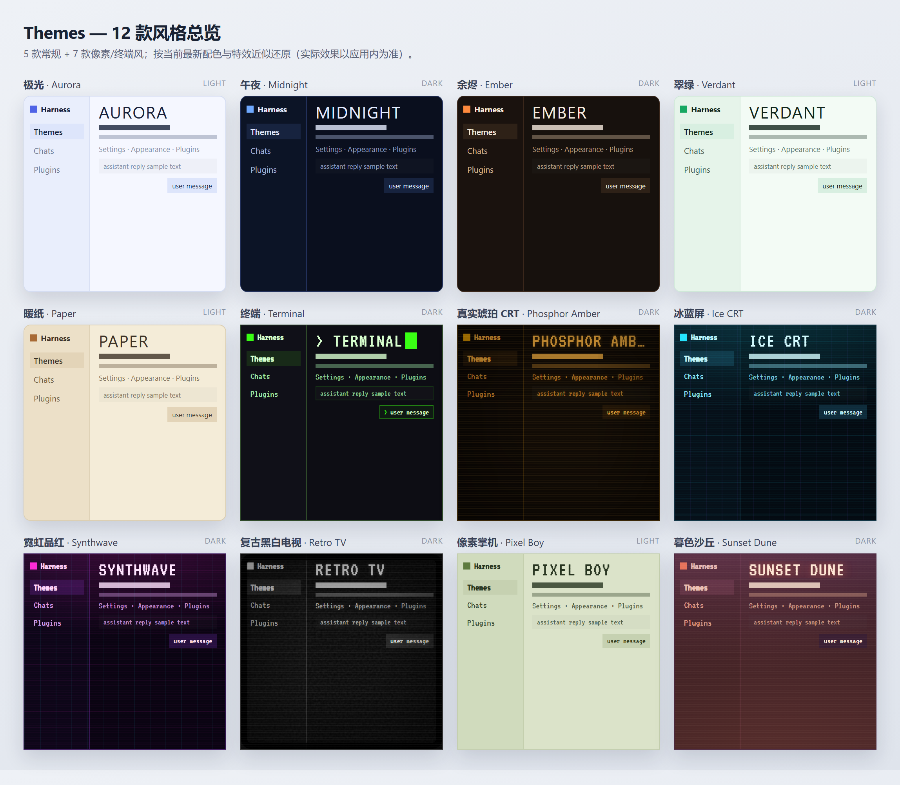
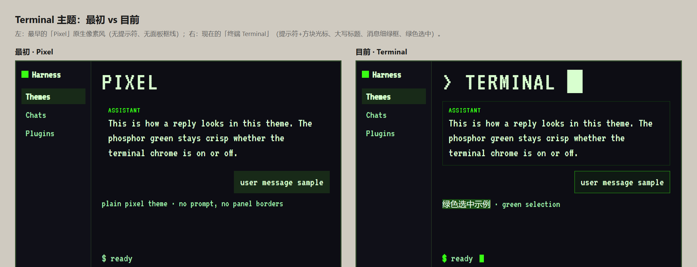

# dsh-retro-pixel-themes · Retro Pixel Themes

> [中文说明](README.md)

A DSH Web **client plugin** that adds a **Retro Pixel Themes** entry to the left sidebar.
Open it to restyle the entire application with one of twelve visual styles (seven of them pixel):

| Style | Mood |
| --- | --- |
| **Aurora** | Cool indigo daylight |
| **Midnight** | Deep navy dark |
| **Ember** | Warm charcoal & amber |
| **Verdant** | Fresh mint light |
| **Paper** | Warm, low-glare paper tone for comfortable long reading |
| **Terminal** | Hacker terminal: phosphor green on black, monospace, prompt cursor, green selection |
| **Phosphor Amber** | True monochrome amber phosphor CRT — vignette, bloom, scanlines |
| **Ice CRT** | Cool cyan CRT glow |
| **Synthwave** | Hot magenta vaporwave neon |
| **Retro TV** | Old black-and-white television: grayscale palette, thick scanlines, film grain, rounded CRT frame |
| **Pixel Boy** | Muted pale-green handheld LCD: scanlines, pixel font |
| **Sunset Dune** | Dusk gradient of amber, rose and violet — soft warm glow |

## How it works

- **Left sidebar entry** — registers a `sidebar.panellist` icon (ordering next to
  the other global panels) and a matching `main` page, so the studio opens as a
  full centre-column page.
- **App-wide restyle** — registers twelve themes on the built-in `ctx.theme`
  service (`--dsw-alias-*` / `--dsw-specific-*` token overrides), so every
  surface, the sidebar, text, borders and accents change together. The seven pixel
  styles additionally inject scoped structural CSS under
  `html[data-dsh-look^="pixel"]` (embedded VT323 pixel font, zero corner radius,
  hard shadows, subtle scanlines).
- **Remembered** — the selection is stored in `localStorage`
  (`dsh.look-studio.style`) and re-applied on the next load. "System default"
  restores the built-in light/dark/system preference.

The host half is a no-op (`index.js`); everything visible lives in `client.js`.

## Screenshots







More: [Amber CRT & Sunset Dune](docs/amber-sunset.png) · [Pixel Boy](docs/pixel-boy.png) · [Retro TV](docs/retrotv.png)

## Installation (for DSH users)

1. Add the plugin to your DSH profile as a dependency and to `dsh.profile.bundles`:

   ```json
   {
     "dependencies": { "dsh-retro-pixel-themes": "github:P3terHan/dsh-retro-pixel-themes" },
     "dsh": { "profile": { "bundles": ["...existing...", "dsh-retro-pixel-themes"] } }
   }
   ```

2. Install dependencies / restart DeepSeek Harness. The **Retro Pixel Themes** entry appears in the left sidebar.

> Requires a DeepSeek Harness build that ships the client theme/sidebar/locale plugins
> (`@deepseek-ai/dsh-client-ui-theme`, `-ui-sidebar`, `-locale`), which standard DSH desktop/web
> profiles include.

## Development

No build step: `client.js` is a hand-written ES module loaded through `window.__ModuleLoader__`.
Edit it, then reload the client bundle (or restart DSH). `index.js` is a no-op host half and
`cordis.patch.yml` inserts the bundle into the profile.

## License

MIT © 2026 P3terHan
