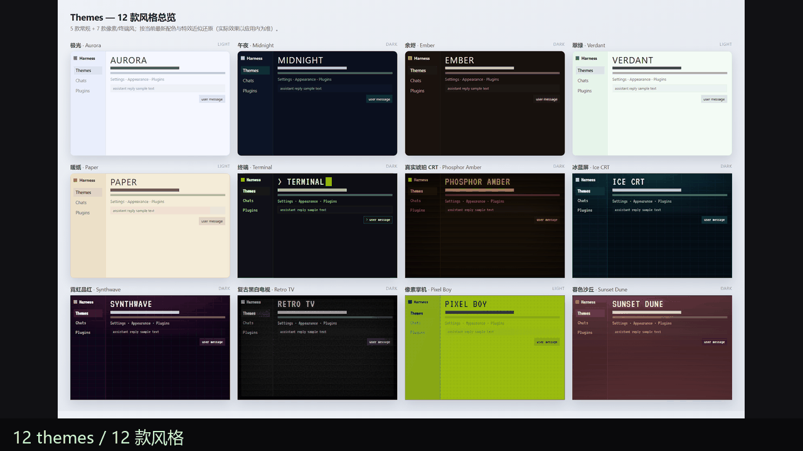
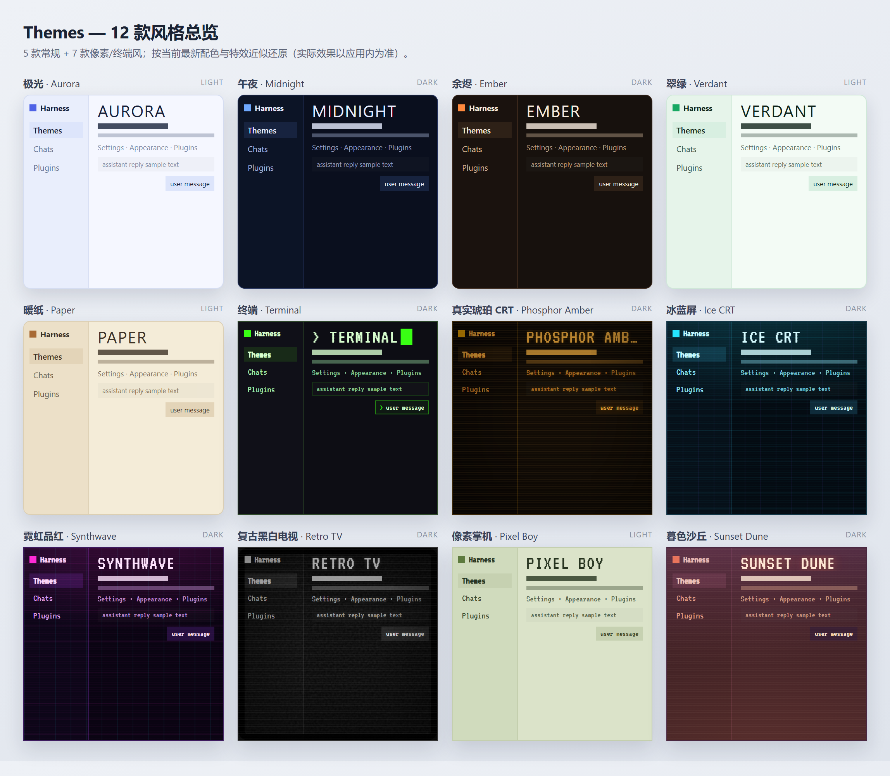
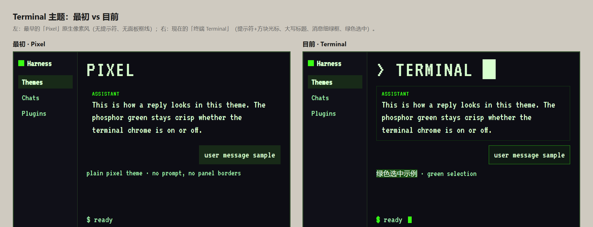

# dsh-retro-pixel-themes（复古像素主题）

> [English README](README.en.md)

一个 DeepSeek Harness 的 **Web 客户端插件**，在**左侧边栏**加入一个「复古像素主题」入口。
打开后可以用**十二种整体风格（其中七款像素）**为整个应用换肤：

| 风格 | 气质 |
| --- | --- |
| **极光 Aurora** | 冷调靛蓝日光，柔和蓝色表面 |
| **午夜 Midnight** | 深邃藏青暗色，配清晰蓝色强调 |
| **余烬 Ember** | 温暖炭灰与流动琥珀色 |
| **翠绿 Verdant** | 清新薄荷日光，绿色强调 |
| **暖纸 Paper** | 温暖、低眩光的纸色，适合长时间阅读护眼 |
| **终端 Terminal** | 黑客终端：黑底荧光绿、等宽字体、提示符光标、绿色选中 |
| **真实琥珀 CRT Phosphor Amber** | 纯单色琥珀磷光终端：暗角、辉光、粗扫描线 |
| **冰蓝屏 Ice CRT** | 清冷的冰蓝 CRT 荧光 |
| **霓虹品红 Synthwave** | 品红霓虹的蒸汽波风 |
| **复古黑白电视 Retro TV** | 复古旧式黑白电视：灰阶、粗扫描线、胶片颗粒、圆角 CRT 屏框 |
| **像素掌机 Pixel Boy** | 低饱和浅绿掌机液晶屏：扫描线、像素字体 |
| **暮色沙丘 Sunset Dune** | 琥珀→玫瑰→暮紫的黄昏渐变，柔和暖光 |

## 工作原理

- **左侧边栏入口** —— 注册一个 `sidebar.panellist` 图标（排在其它全局面板图标旁）以及对应的
  `main` 页面，因此它会作为一个整栏页面打开。
- **整体换肤** —— 在内置的 `ctx.theme` 服务上注册十二个主题（覆盖 `--dsw-alias-*` /
  `--dsw-specific-*` 令牌），让每个界面、侧边栏、文字、边框与强调色一起变化。七款像素风还会额外在
  `html[data-dsh-look^="pixel"]` 下注入限定范围的结构样式（内嵌 VT323 像素字体、零圆角、硬阴影、
  细扫描线），其余风格保持正常圆润界面。
- **记住选择** —— 选择保存在 `localStorage`（`dsh.look-studio.style`），下次加载自动恢复；
  点「系统默认」会恢复内置的 浅色 / 深色 / 跟随系统 主题。

宿主半边是空操作（`index.js`）；所有可见行为都在 `client.js` 里。

## 安装到 profile

本插件已作为 `link:` 依赖加入 `~/.dsh/profiles/desktop` 的 `package.json` 与
`dsh.profile.bundles`，并在该 profile 的 `node_modules` 里建立了指向本目录的联接。
重启应用即会加载；运行中也可以通过插件市场热挂载（无需重启）。

## 使用

1. 点左侧边栏的 **复古像素主题（Retro Pixel Themes）**。
2. 在页面中点选喜欢的风格，立即生效并被记住。
3. 点 **系统默认** 可随时恢复内置主题。

## 文件

| 文件 | 说明 |
| --- | --- |
| `index.js` | 宿主半边（空的 `apply`） |
| `client.js` | 客户端：左侧边栏入口、十二种主题（含七款像素）、像素样式与主题页面 |
| `cordis.patch.yml` | 打包层插入条目 |
| `locale/en.json`、`locale/zh.json` | 插件市场的展示文案 |
| `icon.svg` | 插件图标 |
| `README.md`、`README.en.md` | 中文 / 英文说明 |

## 截图







更多：[真实琥珀 CRT 与暮色沙丘](docs/amber-sunset.png) · [像素掌机](docs/pixel-boy.png) · [复古黑白电视](docs/retrotv.png)

## 安装（DSH 用户）

1. 把插件作为依赖加入你的 DSH profile，并加入 `dsh.profile.bundles`：

   ```json
   {
     "dependencies": { "dsh-retro-pixel-themes": "github:P3terHan/dsh-retro-pixel-themes" },
     "dsh": { "profile": { "bundles": ["...已有...", "dsh-retro-pixel-themes"] } }
   }
   ```

2. 安装依赖 / 重启 DeepSeek Harness，左侧边栏即可看到 **复古像素主题** 入口。

> 需要携带客户端 theme/sidebar/locale 插件的 DeepSeek Harness 版本
> （`@deepseek-ai/dsh-client-ui-theme`、`-ui-sidebar`、`-locale`），标准 DSH 桌面/网页 profile 均包含。

## 开发

无需构建：`client.js` 是手写的 ES 模块，通过 `window.__ModuleLoader__` 加载。
改完后重新加载客户端 bundle（或重启 DSH）即可。`index.js` 是空的宿主半边，
`cordis.patch.yml` 负责把 bundle 插入 profile。

## 许可

MIT © 2026 P3terHan
